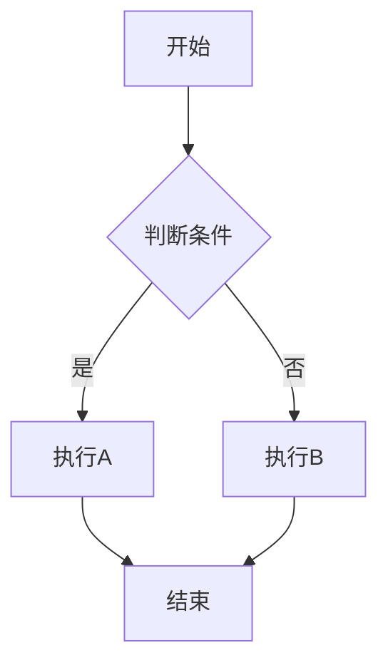
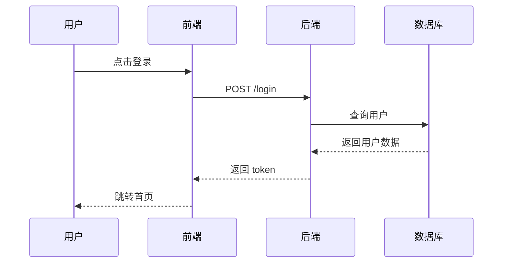

# Markdown Syntax Guide | Markdown 完整语法与工程实践指南

> 从基础标记到 GFM 扩展、Mermaid 流程图、GitHub 警示块与机器学习 LaTeX 公式排版。

---

## 目录

1. [什么是 Markdown](#1-什么是-markdown)
2. [Markdown 编辑器推荐](#2-markdown-编辑器推荐)
3. [标题](#3-标题)
4. [段落与换行](#4-段落与换行)
5. [文本格式化](#5-文本格式化)
6. [列表](#6-列表)
7. [链接](#7-链接)
8. [图片](#8-图片)
9. [代码](#9-代码)
10. [引用](#10-引用)
11. [分割线](#11-分割线)
12. [表格](#12-表格)
13. [任务列表](#13-任务列表)
14. [脚注](#14-脚注)
15. [Emoji 表情](#15-emoji-表情)
16. [HTML 在 Markdown 中的使用](#16-html-在-markdown-中的使用)
17. [转义字符](#17-转义字符)
18. [扩展语法（GFM / Mermaid / LaTeX）](#18-扩展语法)
19. [Markdown 风格与最佳实践](#19-markdown-风格与最佳实践)
20. [Markdown 变体与选择](#20-markdown-变体与选择)

---

## 1. 什么是 Markdown

**Markdown** 是一种**轻量级标记语言**，由 **John Gruber** 和 **Aaron Swartz** 于 2004 年创建。它的设计目标是：**用纯文本就能写出格式丰富的文档，而且源文件本身读起来也很自然。**

```
核心理念：让写作的人专注于内容，而不是排版。
```

**三个关键特点：**
- **易读易写**：即使是源码（`.md` 文件），不看渲染结果也能轻松阅读
- **纯文本**：文件后缀为 `.md` 或 `.markdown`，可以用任何文本编辑器打开
- **转换灵活**：可以转换成 HTML、PDF、Word、电子书等格式

**Markdown 用在哪里？**
- GitHub / GitLab 上的 README、Issue、Pull Request
- 技术文档、博客文章（如 Hexo、Hugo、Jekyll）
- 笔记软件（Obsidian、Notion、Typora、思源笔记）
- 论坛和社区（Stack Overflow、Reddit、Discord）
- 本书指南中的 `.md` 文件

---

## 2. Markdown 编辑器推荐

| 编辑器 | 类型 | 特点 |
|--------|------|------|
| **VS Code**（+ 插件） | 免费 | 程序员首选，实时预览，Git 集成 |
| **Typora** | 免费（旧版）/ 付费 | 所见即所得，排版优美 |
| **Obsidian** | 免费 | 双向链接，知识管理神器 |
| **Notion** | 免费 | 在线协作，多功能集成 |
| **MarkText** | 免费开源 | 简洁的所见即所得编辑器 |

---

## 3. 标题

使用 `#` 号标记标题，`#` 的数量对应标题级别（1～6 级）。

```markdown
# 一级标题（最大）
## 二级标题
### 三级标题
#### 四级标题
##### 五级标题
###### 六级标题（最小）
```

**渲染效果：**

> # 一级标题
> ## 二级标题
> ### 三级标题
> #### 四级标题
> ##### 五级标题
> ###### 六级标题

**语法细节：**
- `#` 和标题文字之间**必须有一个空格**
- 建议在标题前后各空一行（可读性更好）
- 部分编辑器支持在标题末尾再加 `#`（纯装饰，不影响渲染）：
  ```markdown
  ### 这是标题 ###
  ```

**替代写法（Setext 风格）**：仅支持一级和二级标题。

```markdown
一级标题
========

二级标题
--------
```

- 用 `=`（等号）或 `-`（减号）在标题下方画一条线
- 数量不限，但至少需要 3 个
- 这种写法在原始 Markdown 规范中就有，但 `#` 写法更流行

**最佳实践：**
- 每个页面**只在顶部用一个一级标题**（类似 HTML 的 `<h1>`）
- 标题层级要连贯：别从 `#` 直接跳到 `###`

---

## 4. 段落与换行

### 4.1 段落

```markdown
这是第一段。

这是第二段。
```

- 段落之间用**空行**（两次 Enter）分隔
- 只按一次 Enter 不会产生新段落，只会产生一个空格

### 4.2 换行（软换行）

有**三种方式**在段内换行：

```markdown
方式一：行末加两个空格再按 Enter（传统方式）
第一行··
第二行

方式二：行末加反斜杠 \（部分编辑器支持）
第一行\
第二行

方式三：使用 HTML 的 <br> 标签（最可靠）
第一行<br>第二行
```

- `··` 表示两个空格（显示器上看不见，但确实存在）
- 方式三最可靠，在所有平台都不会出问题

### 4.3 空白与缩进

Markdown 会自动忽略多余的空格和缩进。如果你需要**保留原样格式**（如诗歌、ASCII 艺术），见下文代码块中的"不使用语法高亮"示例。

---

## 5. 文本格式化

### 5.1 粗体

```markdown
**这是粗体文字**
__这也是粗体文字__
```

- 用 `**` 或 `__` 包裹文字
- `**` 更通用、更推荐

### 5.2 斜体

```markdown
*这是斜体文字*
_这也是斜体文字_
```

- 用 `*` 或 `_` 包裹文字
- `*` 更通用、更推荐

### 5.3 粗斜体

```markdown
***这是粗斜体文字***
**_这样也可以_**
```

- 三种或以上的 `*` / `_` 组合

### 5.4 删除线

```markdown
~~这段文字被删除了~~
```

**渲染效果：** ~~这段文字被删除了~~

### 5.5 高亮标记（部分编辑器支持）

```markdown
==高亮文字==
```

- 不是标准 Markdown 语法，但被 Typora、Obsidian 等广泛支持
- GitHub 不支持此语法

### 5.6 下划线

Markdown 本身没有下划线语法。需要用到 HTML：

```markdown
<u>带下划线的文字</u>
```

> **建议**：尽量避免下划线，网页上下划线通常表示"可点击的链接"，用下划线装饰文字会造成混淆。

### 5.7 下标与上标（部分编辑器支持）

```markdown
水分子：H~2~O    下标
面积：100m^2^     上标
```

- 非标准语法，Typora、Obsidian 等编辑器支持
- GitHub 不支持，需要使用 HTML 标签 `<sub>` 和 `<sup>`：
  ```markdown
  H<sub>2</sub>O
  100m<sup>2</sup>
  ```

---

## 6. 列表

### 6.1 无序列表

```markdown
- 苹果
- 香蕉
- 橙子
```

也可以使用 `*` 或 `+`：

```markdown
* 苹果
* 香蕉

+ 苹果
+ 香蕉
```

- 标记符号 `-`、`*`、`+` 任选一种，**混用也可以**（但建议统一用 `-`）
- 标记后面**必须有一个空格**
- 渲染效果是圆点（`·`）

**嵌套列表**：子列表前缩进两个或四个空格：

```markdown
- 水果
  - 苹果
  - 香蕉
- 蔬菜
  - 白菜
  - 萝卜
```

渲染效果：

> - 水果
>   - 苹果
>   - 香蕉
> - 蔬菜
>   - 白菜
>   - 萝卜

### 6.2 有序列表

```markdown
1. 第一步
2. 第二步
3. 第三步
```

**渲染效果：**

> 1. 第一步
> 2. 第二步
> 3. 第三步

**语法细节：**
- 数字可以随便写（如 `1.` `1.` `1.`），渲染时都会**自动递增为 1、2、3**
- 但建议写实际数字——不渲染时（看源码）也能读懂顺序
- 起始编号不是 1？部分编辑器支持用第一个数字作为起始值：
  ```markdown
  3. 从3开始
  4. 然后是4
  ```
  （但不如手动写实际数字可靠；如需严格控制起始编号，用 HTML 的 `<ol start="3">`）

### 6.3 混合嵌套

有序列表和无序列表可以互相嵌套：

```markdown
1. 第一项
   - 子项目A
   - 子项目B
2. 第二项
   1. 子步骤一
   2. 子步骤二
```

### 6.4 列表中的多段落

如果列表项内部有多个段落，后续段落需要缩进对齐：

```markdown
1. 这是第一段。

   这是第二段（缩进4个空格与列表文字对齐）。

2. 下一个列表项。
```

- 缩进要跟列表文字对齐（即 4 个空格，因为 `1.` `空格` 占了 3 个字符）

### 6.5 列表中的代码块

代码块需要缩进 8 个空格（或一个 Tab + 4 空格）以对齐列表内容：

```markdown
1. 列表项介绍：

    ```python
    print("Hello")
    ```
```

---

## 7. 链接

### 7.1 行内链接

```markdown
[显示的链接文字](https://www.example.com)
```

**渲染效果：** [显示的链接文字](https://www.example.com)

### 7.2 带标题的链接

```markdown
[显示的链接文字](https://www.example.com "鼠标悬停时显示的提示文字")
```

- 标题（title）是可选的，写在 URL 后面，用双引号包裹
- 鼠标悬停时显示提示

### 7.3 引用式链接

适合多次引用同一 URL 的情况，便于集中管理：

```markdown
[GitHub][1]
[Google][2]

[1]: https://github.com
[2]: https://google.com
```

也可以把引用定义写在文档末尾（推荐），渲染时引用定义本身不会显示。引用标识不一定是数字，也可以是文字：

```markdown
这是一个指向[百度][baidu]的链接。

[baidu]: https://www.baidu.com "点击访问百度"
```

### 7.4 自动链接

用 `<>` 包裹 URL 或邮箱，自动生成可点击的链接：

```markdown
<https://www.example.com>
<example@email.com>
```

**渲染效果：** <https://www.example.com>  &nbsp;  <example@email.com>

### 7.5 页面内跳转（锚点链接）

```markdown
[跳转到第三章](#3-标题)

### 3. 标题
```

- 锚点名 = 标题文字的**小写形式**，空格替换为 `-`，并去掉标点符号
- GitHub 会自动给每个标题生成锚点

---

## 8. 图片

### 8.1 基本语法

```markdown

```

**示例：**

```markdown

```

- `!` 开头表示这是图片（区别于链接）
- `[]` 中是替代文字（alt text），图片无法加载时显示
- `()` 中是图片 URL

### 8.2 带标题的图片

```markdown

```

### 8.3 引用式图片

```markdown
![替代文字][image-id]

[image-id]: 图片URL "图片标题"
```

### 8.4 可点击的图片（图片 + 链接）

```markdown
[](目标链接URL)
```

- 把图片语法嵌套在链接语法里面
- 点击图片会跳转到目标链接

### 8.5 图片尺寸控制

**标准 Markdown 不支持**设置图片尺寸。需要借助 HTML：

```markdown

```

部分扩展语法（如 GitHub 不原生支持，但某些编辑器支持）：

```markdown


```

---

## 9. 代码

### 9.1 行内代码

```markdown
使用 `console.log()` 函数输出信息。
```

**渲染效果：** 使用 `console.log()` 函数输出信息。

- 用单个反引号 `` ` `` 包裹
- 如果代码内本身包含反引号，用**双反引号**包裹：
  ```markdown
  `` ` `` 这是一个反引号字符 ``
  ```

### 9.2 代码块（围栏式，推荐）

````markdown
```python
def hello():
    print("Hello, World!")
    return True
```
````

- 用三个反引号 ` ``` ` 包裹
- 开头 ` ``` ` 后面可以加语言标识符来启用**语法高亮**
- 结尾的三个反引号必须单独占一行

**常用语言标识符：**

| 标识符 | 语言 | 标识符 | 语言 |
|--------|------|--------|------|
| `python` / `py` | Python | `javascript` / `js` | JavaScript |
| `html` | HTML | `css` | CSS |
| `bash` / `sh` | Shell | `powershell` / `ps` | PowerShell |
| `java` | Java | `cpp` / `c++` | C++ |
| `sql` | SQL | `json` | JSON |
| `yaml` / `yml` | YAML | `markdown` / `md` | Markdown |
| `typescript` / `ts` | TypeScript | `rust` / `rs` | Rust |
| `go` / `golang` | Go | `diff` | Diff / 代码对比 |
| `text` | 纯文本（无高亮） | 不写 | 不写则不启用高亮 |

### 9.3 代码块（缩进式，传统方式）

每行代码前缩进**四个空格**或一个 Tab：

```markdown
    def hello():
        print("Hello, World!")
```

- 不支持语法高亮
- 不能指定语言
- **不推荐使用**，围栏式更好

### 9.4 代码块内的转义

在代码块中，所有 Markdown 语法都**原样输出**，不需要转义。你可以安全地展示：

````markdown
```markdown
# 这是一个标题
**粗体** *斜体*
```
````

- 如果你的代码块内容包含 ` ``` `，用更多反引号包裹：
  `````markdown
  ````markdown
  这里演示围栏式代码块：```python```
  ````
  `````
  （外层用了 4 个反引号，内层 3 个就不会冲突）

---

## 10. 引用

### 10.1 基本引用

```markdown
> 这是一段引用内容。
```

**渲染效果：**

> 这是一段引用内容。

### 10.2 多行引用

```markdown
> 第一行引用
> 第二行引用
> 第三行引用
```

- 每行前面都要加 `>`
- 也可以只在第一行加 `>`，后面空行不写 `>`——但可读性差，不推荐

### 10.3 多层嵌套引用

```markdown
> 第一层引用
>> 第二层嵌套引用
>>> 第三层嵌套引用
```

**渲染效果：**

> 第一层引用
> > 第二层嵌套引用
> > > 第三层嵌套引用

### 10.4 引用中包含其他元素

引用块内可以放任何 Markdown 元素：

```markdown
> ### 引用中的标题
>
> - 列表项1
> - 列表项2
>
> ```python
> print("引用中的代码块")
> ```
>
> 还有**粗体**和*斜体*。
```

---

## 11. 分割线

```markdown
---

***

___

---
```

- 三个或以上的 `-`（减号）、`*`（星号）、`_`（下划线）单独成行
- **推荐用 `---`**（和 YAML front matter 一致，也更像排版中的分隔线）
- 前后建议各空一行

**渲染效果：** 三个例子都会画出一条水平线。

> ---

> ⚠️ **注意**：`---` 如果前面没有空行且紧跟在文字下方，部分解析器可能会将其解释为二级标题（Setext 风格）。建议始终在分割线上方空出一行。

---

## 12. 表格

### 12.1 基本表格

```markdown
| 姓名 | 年龄 | 城市 |
|------|------|------|
| 张三 | 25   | 北京 |
| 李四 | 30   | 上海 |
| 王五 | 28   | 广州 |
```

**渲染效果：**

| 姓名 | 年龄 | 城市 |
|------|------|------|
| 张三 | 25   | 北京 |
| 李四 | 30   | 上海 |
| 王五 | 28   | 广州 |

### 12.2 语法说明

- 第一行：**表头**
- 第二行：**分隔行**（必须），由 `|`、`-` 和 `:` 构成
- 第三行起：**数据行**
- 最左和最右的 `|` 可以省略（但建议保留，可读性好）
- 列数必须一致；如果某个单元格为空，也要写占位

**对齐方式**（在分隔行设置）：

```markdown
| 默认对齐 | 左对齐 | 居中对齐 | 右对齐 |
|---------|:------|:-------:|------:|
| 数据     | 数据   | 数据     | 数据   |
```

| 分隔行写法 | 对齐方式 |
|-----------|----------|
| `------` | 默认（通常是左对齐） |
| `:-----` | 左对齐 |
| `:----:` | 居中对齐 |
| `-----:` | 右对齐 |

- `:` 的位置决定了该列的对齐方式
- 分隔行的 `-` 数量不限，每个至少一个

### 12.3 表格内换行

单元格内需要换行，使用 `<br>`：

```markdown
| 列1 | 列2 |
|-----|-----|
| 单行内容 | 第一行<br>第二行 |
```

### 12.4 表格中插入特殊字符

表格中的 `|` 需要转义为 `\|` 或使用 HTML 实体 `&#124;`：

```markdown
| 运算符 | 说明 |
|--------|------|
| `\|`   | 管道符号 |
| `&#124;` | 也是管道符号 |
```

---

## 13. 任务列表

```markdown
- [ ] 未完成的任务
- [x] 已完成的任务
- [ ] 另一个待办事项
```

**渲染效果：**

> - [ ] 未完成的任务
> - [x] 已完成的任务
> - [ ] 另一个待办事项

**语法细节：**
- `[ ]` 中间有一个空格表示"未完成"；`[x]` 或 `[X]` 表示"已完成"
- `]` 和后面的文字之间**必须有一个空格**
- 原是 GitHub Flavored Markdown（GFM）的扩展，现已被广泛支持

---

## 14. 脚注

```markdown
Markdown 是一种轻量级标记语言[^1]。

[^1]: 由 John Gruber 和 Aaron Swartz 于 2004 年创建。
```

**渲染效果：**（脚注通常出现在页面最底部）

> Markdown 是一种轻量级标记语言[^1]。
>
> ---
> [^1]: 由 John Gruber 和 Aaron Swartz 于 2004 年创建。

**语法细节：**
- 在正文中用 `[^标识]` 标记脚注位置
- 在文档任意位置（通常放在末尾）用 `[^标识]: 脚注内容` 定义脚注
- 标识可以是数字或文字，如 `[^note1]`、`[^important]`
- 脚注的渲染位置由解析器决定，通常在页面底部
- GitHub 从 2025 年起开始支持脚注

---

## 15. Emoji 表情

### 15.1 快捷代码（推荐）

```markdown
:smile: :heart: :thumbsup: :rocket: :tada:
```

- 在 GitHub、Notion、Discord 等平台广泛支持
- 插入时 `:` 后会自动弹出表情选择（支持此功能的编辑器）

**常用快捷代码：**

| 代码 | 表情 | 代码 | 表情 |
|------|------|------|------|
| `:smile:` | 😄 | `:heart:` | ❤️ |
| `:+1:` / `:thumbsup:` | 👍 | `:-1:` / `:thumbsdown:` | 👎 |
| `:rocket:` | 🚀 | `:tada:` | 🎉 |
| `:warning:` | ⚠️ | `:bulb:` | 💡 |
| `:bug:` | 🐛 | `:fire:` | 🔥 |
| `:star:` | ⭐ | `:check:` | ✅ |
| `:x:` | ❌ | `:question:` | ❓ |
| `:memo:` | 📝 | `:book:` | 📖 |
| `:link:` | 🔗 | `:wrench:` | 🔧 |

### 15.2 直接粘贴 Emoji

大多数现代编辑器支持直接粘贴 Emoji 字符（从系统表情面板复制）。如 `❤️`、`🚀`、`🎉`。

**Windows 快捷键**：`Win` + `.`（句号）打开表情面板  
**Mac 快捷键**：`Control` + `Command` + `Space`

---

## 16. HTML 在 Markdown 中的使用

Markdown 的一个强大特性是：**可以直接嵌入 HTML 代码**。当 Markdown 语法无法满足需求时，HTML 是最佳"扩展"方式。

### 16.1 行内 HTML

```markdown
这是 <span style="color: red;">红色文字</span> 和 <u>下划线</u>。
```

### 16.2 块级 HTML

```markdown
<div style="background: #f0f0f0; padding: 10px; border-radius: 5px;">

**注意：** 这是一个用 HTML 包裹的提示块。

</div>
```

- HTML 块级元素前后的空行很重要
- HTML 块级标签中不能再使用 Markdown 语法（部分编辑器支持，但不可靠——最稳妥的做法是在 HTML 标签内全部用 HTML 语法）

### 16.3 常见用途

```markdown
<!-- 居中对齐 -->
<p align="center">居中文字</p>

<!-- 图片尺寸 -->


<!-- 折叠内容（GitHub 常用） -->
<details>
<summary>点击展开</summary>

这里是被折叠的内容。
</details>

<!-- 键盘按键 -->
按 <kbd>Ctrl</kbd> + <kbd>C</kbd> 复制

<!-- 上标与下标 -->
x<sup>2</sup> + y<sub>0</sub>

<!-- 注释（不会被渲染） -->
<!-- 这是一条注释，读者看不到 -->

<!-- 视频嵌入 -->
<video src="movie.mp4" controls width="640"></video>
```

### 16.4 支持的 HTML 标签

大多数行内和简单的块级 HTML 标签都被支持（具体取决于渲染平台的安全策略）：

✅ 通常支持：`<div>`、`<span>`、`<p>`、``、`<br>`、`<u>`、`<sup>`、`<sub>`、`<kbd>`、`<details>`、`<summary>`、`<a>`、`<table>`、`<pre>`、`<code>`、`<video>`、`<audio>`

❌ 通常被过滤：`<script>`、`<iframe>`、`<style>`、`<form>`、`<input>`（安全原因）

---

## 17. 转义字符

有时候你想显示一个字符本身（如 `*`），而不是让它触发 Markdown 语法。用反斜杠 `\` 进行转义。

```markdown
\*这不是斜体\*

\# 这不是标题

这是反斜杠本身：\\
```

**渲染效果：** \*这不是斜体\*  &nbsp; ·  &nbsp; \# 这不是标题

### 17.1 可以被转义的字符

| 字符 | 名称 | 转义写法 |
|------|------|----------|
| `\` | 反斜杠 | `\\` |
| `` ` `` | 反引号 | `` \` `` |
| `*` | 星号 | `\*` |
| `_` | 下划线 | `\_` |
| `{}` | 花括号 | `\{\}` |
| `[]` | 方括号 | `\[\]` |
| `()` | 圆括号 | `\(\)` |
| `#` | 井号 | `\#` |
| `+` | 加号 | `\+` |
| `-` | 减号 | `\-` |
| `.` | 句号 | `\.` |
| `!` | 感叹号 | `\!` |
| `|` | 管道符 | `\|` |

### 17.2 代码块中不需要转义

代码块（`` ``` `` 包裹的）中的所有字符原样输出，无需转义。这也是展示 Markdown 语法本身时的常用技巧（"用 Markdown 写 Markdown 教程"）。

---

## 18. 扩展语法

### 18.1 GitHub Flavored Markdown (GFM)

GFM 是 GitHub 对标准 Markdown 的增强版本，新增以下特性：

| 特性 | 说明 | 本文章节 |
|------|------|----------|
| 表格 | `| ... |` 格式 | [第12章](#12-表格) |
| 任务列表 | `- [ ]` / `- [x]` | [第13章](#13-任务列表) |
| 删除线 | `~~文字~~` | [第5章](#54-删除线) |
| 自动链接 | URL 自动变为可点击 | [第7章](#74-自动链接) |
| 代码块语法高亮 | ` ```语言 ` | [第9章](#92-代码块围栏式推荐) |
| SHA 引用 | 提交哈希自动链接 | `a1b2c3d` |
| 用户提及 | @用户名 | `@octocat` |
| Issue/PR 引用 | #编号 | `#123` |

### 18.2 Mermaid 图表（GitHub / GitLab / Notion 支持）

````markdown

````

**常用图表类型：**

| 图表类型 | 代码 | 用途 |
|----------|------|------|
| 流程图 | `graph TD` / `graph LR` | 流程、决策 |
| 时序图 | `sequenceDiagram` | 系统交互、API 调用流程 |
| 类图 | `classDiagram` | UML 类关系 |
| 状态图 | `stateDiagram-v2` | 状态转换 |
| 甘特图 | `gantt` | 项目排期 |
| 饼图 | `pie` | 数据占比 |
| 思维导图 | `mindmap` | 知识结构 |

**时序图示例：**

````markdown

````

### 18.3 LaTeX 数学公式

一些编辑器（Typora、Obsidian、Notion、GitHub）支持 LaTeX 数学公式。

**行内公式**：用 `$` 包裹

```markdown
勾股定理：$a^2 + b^2 = c^2$
```

**块级公式**：用 `$$` 包裹

```markdown
$$
\sum_{i=1}^{n} x_i = x_1 + x_2 + \cdots + x_n
$$
```

**常见公式示例：**

```markdown
分式：$\frac{分子}{分母}$
平方根：$\sqrt{x}$
上下标：$x_i^2$
矩阵：
$$
\begin{bmatrix}
a & b \\
c & d
\end{bmatrix}
$$

AI / 机器学习常用公式实战（西瓜书 / 深度学习常用）：
- Sigmoid 激活函数：$\sigma(z) = \frac{1}{1 + e^{-z}}$
- 均方误差损失 (MSE)：$\mathcal{L}_{MSE} = \frac{1}{n} \sum_{i=1}^{n} (y_i - \hat{y}_i)^2$
- 交叉熵损失 (Cross-Entropy)：$\mathcal{L}_{CE} = -\sum_{k=1}^{K} y_k \log(\hat{y}_k)$
- Softmax 函数：$\text{Softmax}(z_i) = \frac{e^{z_i}}{\sum_{j=1}^{K} e^{z_j}}$
- Transformer 缩放点积注意力 (Scaled Dot-Product Attention)：
$$
\text{Attention}(Q, K, V) = \text{softmax}\left(\frac{Q K^T}{\sqrt{d_k}}\right) V
$$
```

> ⚠️ GitHub 从 2022 年起原生支持 LaTeX 数学公式（`$...$` 和 `$$...$$`）。

### 18.4 GitHub 原生警示块 (Alerts)

GitHub 官方支持的 5 种高亮强调警示块（在开源项目 README 与开发文档中极度推荐使用）：

```markdown
> [!NOTE]
> 强调读者即使快速扫读也不应错过的有用背景信息。

> [!TIP]
> 帮助用户更顺利、更高效完成任务的最佳实践与技巧。

> [!IMPORTANT]
> 关键信息，对用户成功达成目标至关重要。

> [!WARNING]
> 警告紧急信息，可能需要立即注意以避免问题或报错。

> [!CAUTION]
> 针对高风险操作的严厉告诫，避免数据损坏或系统崩溃。
```

渲染效果呈现为带左边框颜色与对应小图标的专业卡片。

### 18.5 YAML Front Matter

在 Markdown 文件开头可以用 `---` 包裹 YAML 数据，用于存储元信息（Jekyll、Hugo、Obsidian、VuePress 等都支持）：

```markdown
---
title: 我的文章标题
date: 2025-01-15
author: 张三
tags:
  - 前端
  - Markdown
description: 这是一篇关于 Markdown 语法的文章
---

# 正文开始
...
```

- Front Matter 本身不会被渲染
- 必须写在文件的**第一行**
- 用两个 `---` 包裹，内部是合法的 YAML

### 18.5 目录（TOC）

部分平台支持自动生成目录：

```markdown
[TOC]
```

或

```markdown
<!-- toc -->
```

- Obsidian、Typora、GitBook 等支持
- GitHub 本身不支持自动 TOC，需要手动编写（如本文档顶部的目录）

---

## 19. Markdown 风格与最佳实践

### 19.1 标题规范

```markdown
✅ # 这是一个标题
❌ #这是一个标题（缺少空格）
❌ #  这是一个标题（多余空格）
```

### 19.2 列表规范

```markdown
✅ - 项目一（推荐用 -）
✅ - 项目二
✅ - 项目三

❌ * 项目一（混用 `*`）
❌ + 项目二（混用 `+`）
```

- 选择一种标记（`-`、`*`、`+`）并**全文统一**
- 编号列表建议写实际数字：`1.` `2.` `3.`（而非全部写 `1.`）

### 19.3 代码规范

```markdown
✅ `console.log("Hello")` —— 行内代码
✅ ```javascript —— 代码块始终带语言标识
✅ ``` —— 单独的结束标记

❌ `console.log("Hello") ` —— 多余空格
❌ ``` JavaScript —— 标识符前多余空格
❌ ```javascript内容 —— 标识符后缺少换行
```

### 19.4 空格规范

```markdown
# 标题前后各空一行
# 标题
第一段。

第二段。
```

- 标题前后有空行（可读性极大提升）
- 代码块前后有空行
- 列表前后有空行
- 不同元素之间尽量留空行

### 19.5 链接规范

```markdown
✅ [GitHub](https://github.com) —— 语义化链接文字
❌ [点击这里](https://github.com) —— "点击这里"缺乏含义
❌ <https://github.com> —— 裸链接，阅读体验差（除非列表末尾）
```

- 链接文字应**描述目标内容**，帮助读者判断是否点击
- 避免"点击这里""链接"这类无信息量的文字

### 19.6 文件命名

- 文件名用**小写英文 + 连字符**：`markdown-guide.md`
- 避免空格：用连字符 `-` 替代
- 避免特殊字符

### 19.7 行宽

建议每行不超过 **80 ～ 120 个字符**。长段落可以手动换行（但保持在同一段落内）以提高 Git diff 的可读性。

---

## 20. Markdown 变体与选择

Markdown 没有唯一的官方标准，存在多个变体：

| 变体 | 维护方 | 使用场景 |
|------|--------|----------|
| **CommonMark** | 社区标准化组织 | 最接近"标准"的规范，Python-Markdown 等实现遵循 |
| **GitHub Flavored Markdown (GFM)** | GitHub | GitHub 平台，也是最广泛使用的变体 |
| **GFM 扩展** | GitLab | 在 GFM 基础上增加更多特性 |
| **Markdown Extra** | Michel Fortin | 增加了表格、脚注、定义列表等 |
| **MultiMarkdown** | Fletcher Penney | 增加了表格、脚注、引用、元数据等 |
| **R Markdown** | RStudio | 主要用于数据科学，嵌入 R/Python 代码 |

**实用建议：**
- 在 GitHub 上写作 → 使用 **GFM** 语法
- 写技术博客（Hugo/Hexo）→ 使用 **CommonMark + Front Matter**
- 个人笔记（Obsidian）→ 使用 **Obsidian 扩展语法**（双向链接 `[[]]` 等）
- 不确定时 → 使用 **基本 Markdown + GFM 扩展**（兼容性最广）

---

## 附录：常用速查表

### 一个例子学会所有常用语法

```markdown
# 我的文档

## 简介

这是一段**粗体**和*斜体*文字，还有 `行内代码`。

- 列表项1
- 列表项2
  - 嵌套项

1. 第一步
2. 第二步

> 这是一段引用。

[百度](https://baidu.com)


---

| 列1 | 列2 |
|-----|-----|
| A   | B   |

```python
print("Hello")
```

- [x] 已完成
- [ ] 未完成

~~删除线~~

H<sub>2</sub>O 是水分子。
```

### 符号速记

| 符号 | 作用 | 符号 | 作用 |
|------|------|------|------|
| `#` | 标题 | `##` | 二级标题 |
| `**` | 粗体 | `*` | 斜体 |
| `` ` `` | 行内代码 | ` ``` ` | 代码块 |
| `-` | 无序列表 | `1.` | 有序列表 |
| `>` | 引用 | `---` | 分割线 |
| `[]()` | 链接 | `` | 图片 |
| `~~` | 删除线 | `\` | 转义 |
| `[ ]` | 未完成 | `[x]` | 已完成 |
| `|` | 表格分隔 | `:` | 表格对齐 |

---

> **学习建议**：Markdown 语法很少，5 分钟就能学会基本用法。最关键的习惯是：**写文档时注意排版、空格、空行的一致性**，这样源码和渲染结果都清晰可读。
